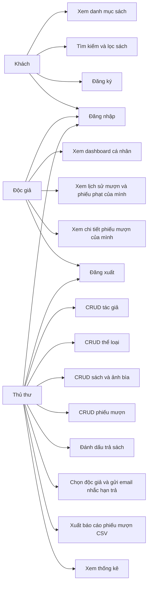
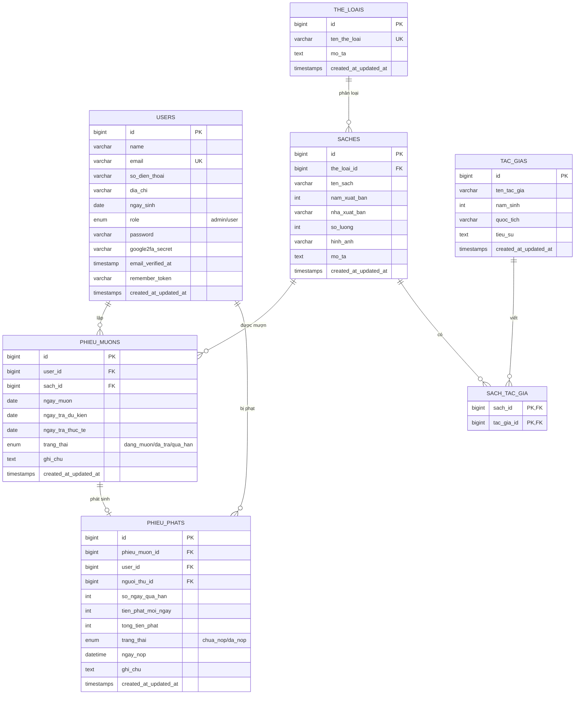

# BÁO CÁO ĐỒ ÁN LẬP TRÌNH MÃ NGUỒN MỞ

## Đề tài: Xây dựng website Quản lý Thư viện

| Thông tin | Nội dung |
|---|---|
| Trường / Khoa | ........................................................ |
| Học phần | Lập trình mã nguồn mở |
| Giảng viên | ........................................................ |
| Lớp | ........................................................ |
| Nhóm | ........................................................ |
| Thành viên | ........................................................ |
| MSSV | ........................................................ |
| Năm học | 2026 |

> Hoàn thiện các dòng thông tin sinh viên trước khi nộp báo cáo.

## 1. Tổng quan đề tài

Website Quản lý Thư viện hỗ trợ thủ thư quản lý sách, tác giả, thể loại và quá trình mượn trả; đồng thời giúp độc giả tra cứu kho sách và theo dõi lịch sử mượn của chính mình. Hệ thống được xây dựng bằng Laravel 13, PHP 8.3, MySQL, Blade và Bootstrap 5.

### 1.1. Mục tiêu

- Số hóa quy trình quản lý sách và phiếu mượn.
- Tách rõ quyền của thủ thư (`admin`) và độc giả (`user`).
- Đảm bảo dữ liệu hợp lệ, tránh cho mượn vượt số lượng sách hiện có.
- Cung cấp tìm kiếm, lọc và phân trang thuận tiện.
- Có giao diện responsive, hỗ trợ sử dụng trên máy tính và điện thoại.

### 1.2. Công nghệ sử dụng

| Thành phần | Công nghệ |
|---|---|
| Backend | Laravel 13, PHP 8.3 |
| Cơ sở dữ liệu | MySQL |
| ORM | Eloquent ORM |
| Giao diện | Blade, Bootstrap 5, SCSS |
| JavaScript | Fetch API cho tìm kiếm AJAX |
| Build tool | Vite |
| Kiểm thử | PHPUnit, Laravel HTTP Test |

## 2. Phân tích yêu cầu

### 2.1. Tác nhân

| Tác nhân | Quyền hạn chính |
|---|---|
| Khách | Xem, tìm kiếm, lọc và xem chi tiết sách; đăng ký, đăng nhập |
| Độc giả | Các quyền của khách; xem dashboard cá nhân và lịch sử phiếu mượn của chính mình |
| Thủ thư | Quản trị tác giả, thể loại, sách, ảnh bìa, phiếu mượn và thao tác trả sách |

### 2.2. Use Case



## 3. Thiết kế cơ sở dữ liệu

### 3.1. ERD



### 3.2. Quan hệ dữ liệu

| Quan hệ | Loại | Ý nghĩa |
|---|---|---|
| `the_loais` – `saches` | 1-N | Một thể loại có nhiều sách; một sách thuộc một thể loại |
| `saches` – `tac_gias` | N-N | Một sách có 1-2 tác giả; một tác giả có thể viết nhiều sách |
| `users` – `phieu_muons` | 1-N | Một độc giả có nhiều phiếu mượn |
| `saches` – `phieu_muons` | 1-N | Một sách có thể xuất hiện trong nhiều phiếu mượn |
| `phieu_muons` – `phieu_phats` | 1-0..1 | Một phiếu mượn quá hạn có tối đa một phiếu phạt |
| `users` – `phieu_phats` | 1-N | Một độc giả có thể phát sinh nhiều phiếu phạt |

### 3.3. Ràng buộc quan trọng

- Email người dùng và tên thể loại là duy nhất.
- Các khóa ngoại có ràng buộc toàn vẹn và xử lý cascade theo migration.
- Khóa chính kép của `sach_tac_gia` ngăn gán trùng cùng tác giả cho một sách.
- `so_luong` không âm; một sách chỉ được mượn khi còn bản khả dụng.
- Ngày trả dự kiến phải bằng hoặc sau ngày mượn; ngày trả thực tế không được trước ngày mượn.
- Ảnh bìa chỉ nhận JPG, PNG hoặc WebP, tối đa 2 MB.

## 4. Thiết kế và tổ chức chương trình

### 4.1. Kiến trúc

Ứng dụng sử dụng mô hình MVC của Laravel:

- **Model:** ánh xạ bảng và khai báo quan hệ Eloquent.
- **View:** Blade component và Bootstrap 5 tạo giao diện responsive.
- **Controller:** điều phối request, truy vấn và trả response.
- **Form Request:** tập trung validation và kiểm tra quyền quản trị.
- **Middleware:** bảo vệ nhóm route theo role.
- **Migration / Seeder / Factory:** quản lý schema, dữ liệu mẫu và dữ liệu kiểm thử.

### 4.2. Phân quyền

| Khu vực | Khách | User | Admin |
|---|:---:|:---:|:---:|
| Danh mục và chi tiết sách | ✓ | ✓ | ✓ |
| Đăng ký / đăng nhập | ✓ | ✓ | ✓ |
| Dashboard |  | ✓ | ✓ |
| Lịch sử mượn cá nhân |  | ✓ |  |
| Quản lý tác giả |  |  | ✓ |
| Quản lý thể loại |  |  | ✓ |
| Quản lý sách và ảnh bìa |  |  | ✓ |
| Quản lý mượn trả |  |  | ✓ |
| Gửi thông báo nhắc hạn trả |  |  | ✓ |

Middleware `auth` yêu cầu đăng nhập. Middleware `role:admin` hoặc `role:user` kiểm tra vai trò trước khi truy cập. Role không nằm trong `$fillable` của `User`, nên request đăng ký không thể tự gán quyền admin.

## 5. Chức năng đã hoàn thành

### 5.1. Xác thực & Hồ sơ cá nhân

- Đăng ký độc giả.
- Đăng nhập, đăng xuất và ghi nhớ đăng nhập.
- Khôi phục và đặt lại mật khẩu bằng email truyền thống hoặc mã OTP Google Authenticator.
- Điều hướng dashboard theo role.
- Quản lý hồ sơ cá nhân (cập nhật họ tên, số điện thoại, địa chỉ, ngày tháng năm sinh).
- Đổi mật khẩu tài khoản và quản lý liên kết mã bí mật Google Authenticator (TOTP 2FA).

### 5.2. Quản lý tác giả

- Danh sách có tìm kiếm và phân trang.
- Thêm, xem, sửa và xóa tác giả.
- Không cho xóa tác giả đang được gắn với sách.
- Validation tên, năm sinh, quốc tịch và tiểu sử.

### 5.3. Quản lý thể loại

- Danh sách có tìm kiếm và phân trang.
- Thêm, xem, sửa và xóa thể loại.
- Tên thể loại không trùng.
- Không cho xóa thể loại đang có sách.

### 5.4. Quản lý sách

- CRUD sách và chọn 1-2 tác giả.
- Tìm theo tên sách, tác giả hoặc nhà xuất bản; lọc theo thể loại.
- Upload, thay thế và xóa ảnh bìa an toàn.
- Hiển thị tổng số lượng và số bản khả dụng.
- Không cho xóa sách đã có lịch sử mượn.

### 5.5. Quản lý mượn trả

- Lập, xem, sửa và xóa phiếu mượn.
- Lọc theo trạng thái, độc giả và từ khóa.
- Không cho mượn khi sách đã hết bản khả dụng.
- Khóa bản ghi sách khi lập/sửa phiếu để tránh mượn vượt kho do request đồng thời.
- Đánh dấu trả sách và lưu ngày trả thực tế.
- Tự chuẩn hóa trạng thái đang mượn, đã trả hoặc quá hạn.
- Độc giả chỉ xem được phiếu mượn thuộc tài khoản của mình.
- **Hệ thống xử lý vi phạm & Phiếu phạt**: Tự động phát sinh phiếu phạt khi độc giả trả sách quá thời gian quy định hoặc đang giữ sách quá hạn, tự động tính tiền phạt theo công thức `Số ngày quá hạn * 5.000 VNĐ/ngày`, hỗ trợ quản trị viên xác nhận thu tiền và độc giả tra cứu nghĩa vụ nộp phạt.
- Thủ thư có thể xuất toàn bộ kết quả đang tìm kiếm/lọc thành CSV tương thích Excel; dữ liệu được bảo vệ trước CSV formula injection.
- Trang quản trị thông báo chia độc giả thành hai nhóm: phiếu đến hạn hôm nay và phiếu sắp đến hạn ngày mai; hỗ trợ chọn một, nhiều hoặc tất cả độc giả.
- Các phiếu đủ điều kiện của cùng một độc giả được gộp trong một email; hệ thống chống gửi trùng trong ngày và cho phép quản trị viên chủ động gửi lại khi cần.
- Laravel Scheduler tự động gửi email nhắc hạn lúc 08:00 hằng ngày cho độc giả chưa được thông báo trong ngày.

### 5.6. Điểm sáng tạo & Mở rộng (Căn cứ tiêu chí điểm 10)

- **Hệ thống Quản lý Độc giả & Đánh giá Lý lịch mượn sách (Credit Rating)**: Phân loại 5 cấp độ uy tín (Uy tín cao trong sạch, Bình thường, Cần chú ý, Vi phạm, Khóa mượn). Cơ chế tự động kiểm tra lý lịch khi lập phiếu mượn giúp ngăn chặn độc giả đang giữ sách quá hạn hoặc nợ phạt tiếp tục mượn sách mới; tích hợp sổ ghi chú lưu ý riêng của thủ thư về từng độc giả.
- **Hệ thống Phiếu Phạt Quá Hạn (Fine Management System)**: Tự động hóa nghiệp vụ xử phạt sách mượn quá hạn quy định, tính mức phạt 5.000 VNĐ/ngày, ghi nhận người thu tiền, ngày nộp tiền và xuất biên lai phạt.
- **Chống Spam Gửi Mã OTP (Rate Limiting 60 Giây)**: Áp dụng cơ chế kiểm soát tần suất gửi email OTP ở backend kết hợp đồng hồ đếm ngược thời gian thực (live countdown 60s → 0s) và nút gửi lại bị khóa (disabled) trên frontend.
- **Gửi mã OTP qua Email (Gmail SMTP)**: Tích hợp dịch vụ gửi mã OTP 6 số về hòm thư người dùng qua giao thức SMTP Gmail bảo mật, mẫu email HTML trang trọng, kiểm soát thời hạn hiệu lực 10 phút, giới hạn 5 lần thử sai để chống tấn công brute-force.
- **Xác thực Google Authenticator (TOTP - RFC 6238)**: Cho phép quét mã QR để đồng bộ với ứng dụng Google Authenticator trên điện thoại; tạo và xác minh mã OTP 6 số để lấy lại mật khẩu và kích hoạt tài khoản an toàn.
- **Quản lý thông tin độc giả mở rộng**: Bổ sung số điện thoại, ngày sinh, địa chỉ, đổi mật khẩu và nút bật/tắt hiển thị mật khẩu bằng biểu tượng con mắt.
- **Tìm kiếm danh mục bằng AJAX**: Debounce 300ms, không tải lại toàn trang, đồng bộ URL `history.replaceState`.
- **Dashboard thống kê trực quan**: Phân tách nghiệp vụ riêng cho admin và user với thẻ chỉ số màu sắc, quản lý phiếu phạt và bảng phiếu mượn gần đây.
- **Giao diện chuẩn UI/UX Pro Max**: Phong cách Academic Modern, 100% Bootstrap Icons chính quy (không dùng emoji), responsive đa thiết bị.
- **Kiểm soát tồn kho đồng thời**: Sử dụng Database Transaction và Pessimistic Locking (`lockForUpdate`).
- **Nhắc hạn trả sách tự động và có kiểm soát**: Gửi email tổng hợp theo độc giả cho các phiếu đến hạn hôm nay hoặc ngày mai, chọn hàng loạt trên trang quản trị, tự động chạy lúc 08:00, chống gửi trùng bằng cache và hỗ trợ gửi lại có chủ đích.
- **Bộ kiểm thử tự động toàn diện**: 119 automated tests với 398 assertions bao quát phân quyền, validation, upload, tìm kiếm, xuất báo cáo CSV, Google OTP, Email OTP, nhắc hạn trả, phiếu phạt, lý lịch độc giả và cô lập dữ liệu.

## 6. Giao diện

Chèn ảnh chụp màn hình thực tế vào các vị trí sau trước khi xuất PDF:

| STT | Ảnh minh chứng cần chèn | Nội dung cần thể hiện |
|---:|---|---|
| 1 | Trang chủ / danh mục | Danh sách sách, tìm kiếm và lọc thể loại |
| 2 | Đăng nhập | Form đăng nhập tiếng Việt |
| 3 | Dashboard admin | Các thẻ thống kê và phiếu mượn gần đây |
| 4 | Quản lý sách | Bảng dữ liệu, phân trang và thao tác CRUD |
| 5 | Form thêm sách | Validation, chọn tác giả và upload ảnh |
| 6 | Quản lý phiếu mượn | Bộ lọc trạng thái và thao tác trả sách |
| 7 | Lịch sử độc giả | Chỉ hiển thị dữ liệu của user hiện tại |
| 8 | Thông báo hạn trả | Hai nhóm đến hạn/sắp đến hạn, chọn hàng loạt và trạng thái đã gửi |
| 9 | Responsive | Một màn hình trên kích thước điện thoại |

## 7. Kiểm thử

### 7.1. Phạm vi tự động hóa

| Nhóm kiểm thử | Trường hợp chính |
|---|---|
| Authentication / Authorization | Khách bị chuyển đến đăng nhập; user không vào trang admin; đăng ký không thể tự nâng quyền |
| Catalog | Tìm kiếm, lọc, phân trang AJAX, escape dữ liệu đầu ra |
| Sách | CRUD, validation, upload ảnh hợp lệ, từ chối file không phải ảnh |
| Mượn trả | Còn/hết sách, validation ngày, đánh dấu trả |
| Xuất báo cáo | Giữ đúng bộ lọc, nội dung CSV UTF-8, chống CSV formula injection, phân quyền admin |
| Thể loại | CRUD, tên duy nhất, không xóa khi còn sách |
| Quyền riêng tư | User chỉ đọc được phiếu mượn của chính mình |
| Google Authenticator OTP | Xác thực mã 6 số TOTP, giới hạn thời gian, cập nhật mật khẩu mới |
| Email OTP Reset | Gửi mail OTP Gmail SMTP, đếm lần thử sai, hết hạn 10 phút, đặt lại mật khẩu |
| Nhắc hạn trả | Phân nhóm theo ngày, gộp email theo độc giả, chống gửi trùng, gửi lại, phân quyền và lịch chạy 08:00 |

### 7.2. Lệnh kiểm thử

```bash
php artisan test --compact
npm run build
vendor/bin/pint --format agent
php artisan view:cache
php artisan route:list --except-vendor
```

Ghi kết quả cuối cùng tại đây sau lần chạy trước khi nộp:

| Kiểm tra | Kết quả |
|---|---|
| PHPUnit | 119 tests, 398 assertions – Passed 100% |
| Vite production build | Passed |
| Laravel Pint | Passed (Chuẩn PSR-12) |
| Blade compilation | Passed (Không lỗi cú pháp) |
| Browser console | Không có error/warning |

## 8. Cài đặt và chạy chương trình

```bash
composer install
copy .env.example .env
php artisan key:generate
```

Tạo database MySQL tên `QuanLyThuVien`, sau đó cấu hình kết nối trong `.env` và chạy:

```bash
php artisan migrate --seed
php artisan storage:link
npm install
npm run build
composer run dev
```

Cấu hình SMTP trong `.env` để gửi email thật. Trên môi trường triển khai, thêm cron gọi Laravel Scheduler mỗi phút:

```cron
* * * * * cd /duong-dan-den-du-an && php artisan schedule:run >> /dev/null 2>&1
```

Khi chạy thử cục bộ có thể dùng `php artisan schedule:work`. Tác vụ `loans:send-due-reminders` sẽ được Scheduler kích hoạt lúc 08:00 theo múi giờ `Asia/Bangkok`.

Tài khoản mẫu:

| Role | Email | Mật khẩu | Số điện thoại | Google OTP Secret |
|---|---|---|---|---|
| Admin | `admin@gmail.com` | `12345678` | 0901234567 | `JBSWY3DPEHPK3PXP` |
| User | `user1@gmail.com` | `12345678` | 0912345678 | `JBSWY3DPEHPK3PXP` |
| User | `user2@gmail.com` | `12345678` | 0934567890 | `JBSWY3DPEHPK3PXP` |
| User | `user3@gmail.com` | `12345678` | 0987654321 | `JBSWY3DPEHPK3PXP` |

## 9. Phân công công việc

> Thay nội dung mẫu bằng tên và MSSV thật. Mỗi thành viên phải nắm được phần mình thực hiện để trả lời phản biện.

| Thành viên | MSSV | Công việc | Tỷ lệ |
|---|---|---|---:|
| ................................ | ................................ | Phân tích, database, backend, Google OTP | ....% |
| ................................ | ................................ | Giao diện, kiểm thử, hồ sơ, báo cáo | ....% |

## 10. Đối chiếu tiêu chí chấm điểm (Hướng tới Điểm 10 Tuyệt Đối)

| Nhóm tiêu chí | Tỷ trọng | Minh chứng trong đồ án |
|---|---:|---|
| Chức năng | 40% | CRUD 4 bảng liên quan (Sách, Tác giả, Thể loại, Phiếu mượn), Auth, Role, Hồ sơ cá nhân (SĐT, Ngày sinh, Địa chỉ), Validation tiếng Việt, Tìm kiếm, Lọc, Phân trang, Upload ảnh bìa sách, xuất CSV |
| Kỹ thuật Laravel | 25% | Eloquent relationship (1-N, N-N), Migration, Seeder, Blade Component tái sử dụng, Middleware phân quyền, Form Request, Database Transaction & Lock |
| Giao diện | 15% | Chuẩn UI/UX Pro Max phong cách Academic Modern, Bootstrap 5, SCSS riêng, 100% Bootstrap Icons chính quy, Toast notification, Responsive mượt mà trên mobile & desktop |
| Báo cáo và trình bày | 10% | ERD đầy đủ các trường mới và bảng phiếu phạt, Use Case, mô tả chức năng, hướng dẫn cài đặt, kiểm thử tự động và tài khoản mẫu |
| Sáng tạo & Mở rộng | 10% | Phiếu phạt quá hạn kèm biên lai, nhắc hạn trả tự động qua email lúc 08:00, chống gửi trùng, Email OTP, Google Authenticator (TOTP RFC 6238), AJAX search, xuất CSV tương thích Excel, kiểm soát tồn kho đồng thời và 119 test tự động (398 assertions) |

## 11. Kết luận và hướng phát triển

Đồ án đã đáp ứng hoàn hảo quy trình của một hệ thống quản lý thư viện chuyên nghiệp: quản lý dữ liệu danh mục, sách, tác giả, độc giả, quy trình mượn - trả, nhắc hạn tự động và xử lý vi phạm nộp phạt quá hạn. Hệ thống có phân quyền chặt chẽ, validation tiếng Việt thân thiện, bảo mật OTP đa kênh (Email & Google 2FA), chống spam 60s, kiểm soát tồn kho đồng thời, giao diện responsive và bộ kiểm thử tự động toàn diện đạt 100% test pass. Các hướng phát triển tiếp theo gồm thanh toán điện tử trực tuyến (VNPay/MoMo) cho phiếu phạt và thông báo đẩy qua ứng dụng di động.
